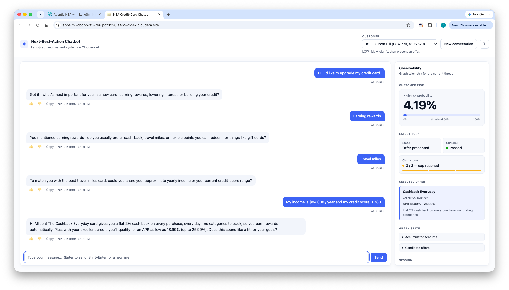
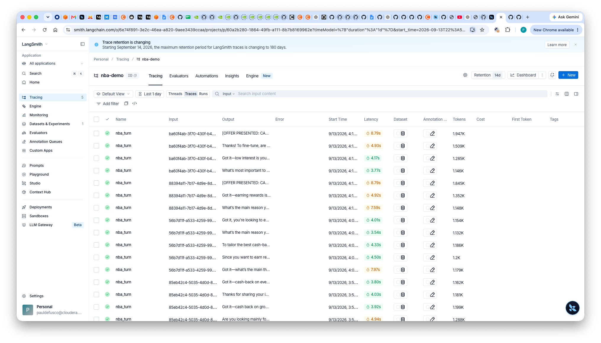
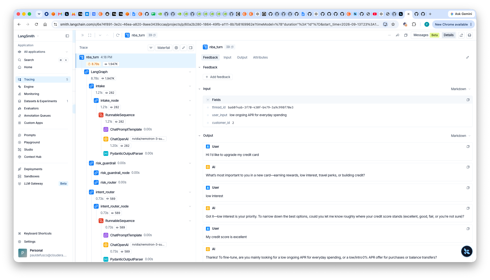
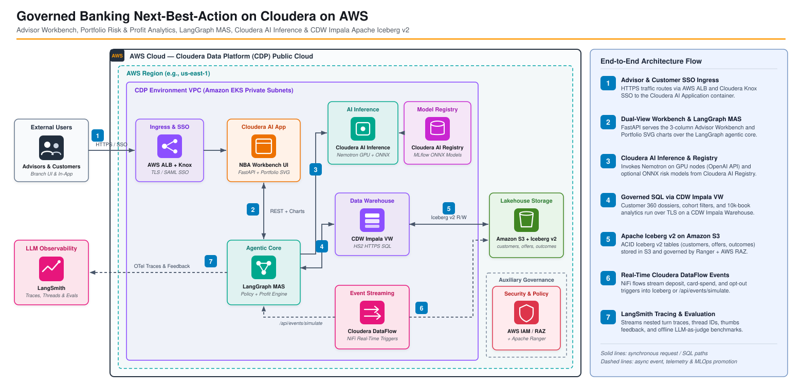
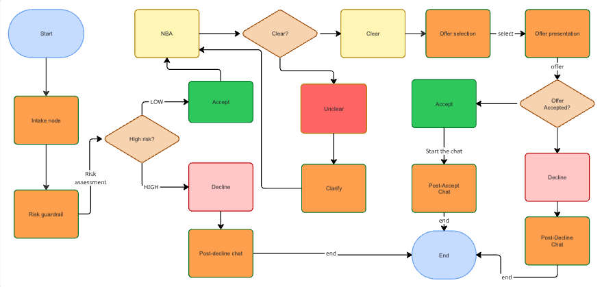
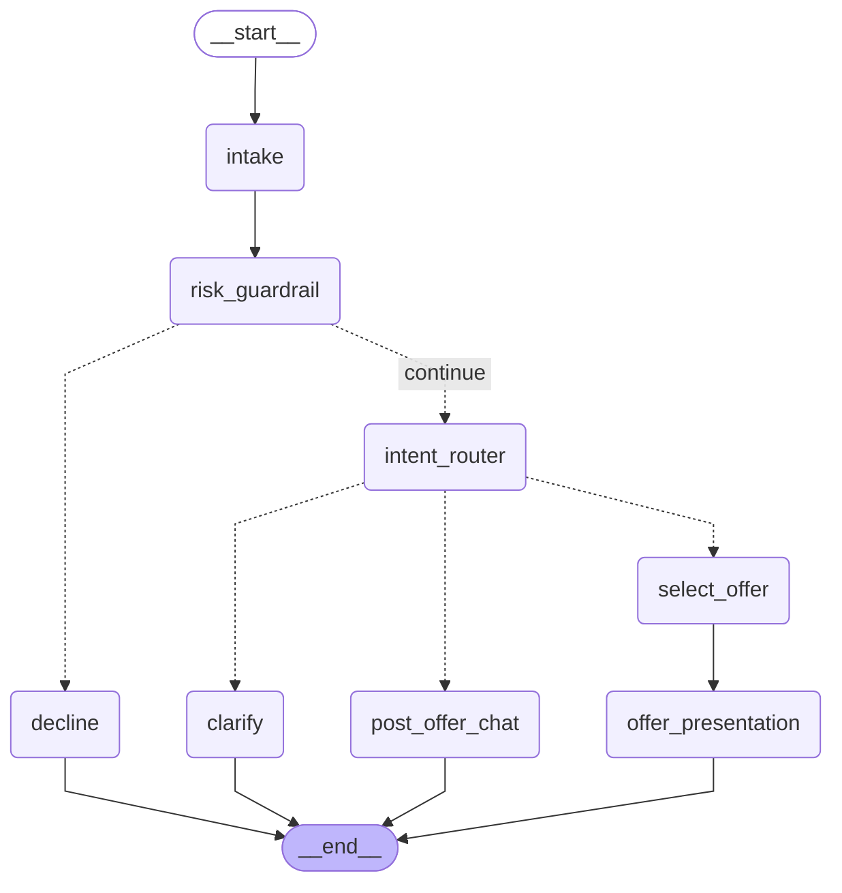

# Cloudera Blueprint: Governed Banking Next-Best-Action — Multi-Agent Workbench & Portfolio Analytics on Cloudera AI

[](https://github.com/pdefusco)
[](LICENSE)
[](requirements.txt)
[](METADATA.yaml)
[](https://github.com/cloudera-applied-ai/AI_Blueprint_Observability-Next-Best-Action/stargazers)
[](https://github.com/cloudera-applied-ai/AI_Blueprint_Observability-Next-Best-Action/network/members)

> An enterprise blueprint for building a **Governed, Hyper-Personalized Retail Banking Next-Best-Action (NBA)** engine on **Cloudera on AWS** — combining a **3-column Branch Advisor Workbench**, a **Portfolio Segmentation, Risk & Profitability Analytics Dashboard**, a **LangGraph** multi-agent workflow, **Apache Iceberg v2 + Cloudera Data Warehouse (CDW) Impala** data architecture (with zero-setup SQLite local fallback), **Cloudera AI Inference Service** (`nemotron` + optional ONNX risk classifier), and end-to-end **LangSmith** tracing and evaluation.


## Table of Contents

- [Overview](#overview)
- [What's New in This Version](#whats-new-in-this-version)
- [Demo](#demo)
- [Use Case & Two-Stage Decisioning](#use-case--two-stage-decisioning)
- [Key Features](#key-features)
- [Quickstart (Local & Cloudera AI Workbench)](#quickstart-local--cloudera-ai-workbench)
- [Deploying on Cloudera on AWS (Iceberg + CDW Impala + CAI)](#deploying-on-cloudera-on-aws-iceberg--cdw-impala--cai)
- [Architecture / Software Components](#architecture--software-components)
- [LangSmith Observability & Evaluation](#langsmith-observability--evaluation)
- [Target Audience](#target-audience)
- [Repository Structure](#repository-structure)
- [Prerequisites & Environment Variables](#prerequisites--environment-variables)
- [Hardware Requirements](#hardware-requirements)
- [Documentation](#documentation)
- [License](#license)
- [Disclaimer](#disclaimer)

## Overview

This blueprint shows how to build, govern, evaluate, and observe a **production-grade multi-product Next-Best-Action banking platform** on Cloudera AI. It brings together three operational surfaces in a single application:

1. **Branch Advisor & Customer In-App Workbench ("Micro" Customer 360 View)** — Advisors search or select any customer across a 10,000-customer book, inspect real-time holdings and risk signals, review **Expected-Profit-ranked offers** alongside a **Governance Suppression Audit** drawer, run a **Quick 12-Month Yield/Savings Simulator**, log conversion outcomes (`ACCEPTED` / `DEFERRED` / `DECLINED`), or switch into a **multi-turn LangGraph AI Chat** with verbatim compliance disclosures.
2. **Portfolio & Risk Analytics Dashboard ("Macro" Book-of-Business View)** — Banking leaders and campaign managers toggle to a full-book visual dashboard displaying headline KPIs, the **Governance-to-Profitability Population Funnel**, **Customer Segmentation × Risk Tier (`LOW` / `MED` / `HIGH`) & Profitable Share**, and **Targetable Population & Expected Net Profit by Product Offer**, with **one-click cohort drill-down** directly into the Advisor Workbench.
3. **LangSmith Observability & Offline Evaluation Plane** — Every conversational turn is traced to **LangSmith** with per-thread grouping and thumbs feedback, backed by repeatable golden-dataset evaluation notebooks using deterministic and Nemotron LLM-as-judge scorers.

> **Guardrail status.** The customer-risk and governance guardrail runs deterministically in `app/nba_app.py` (`_evaluate_governance_gate`) and `app/offer_rules.py` — no external classifier endpoint is required to run end-to-end. An ML-backed ONNX risk classifier (XGBoost / PyTorch → Cloudera AI Registry → Cloudera AI Inference Service) is provided under `xgboost/` and `pytorch_train/` for teams deploying the full MLOps pipeline.

## What's New in This Version

- **Portfolio Segmentation, Risk & Profitability Analytics View (`app/web/src/analytics.ts`, `GET /api/analytics/portfolio`)**
  - Top-bar workspace switcher between **Advisor Workbench** and **Portfolio & Risk Analytics**.
  - **4 Executive KPI Cards**: Total Customer Book (`10,000`), Suppressed by Governance (`DNS`, `<14d` contact cooldown, credit blocks), Profitable Targetable Cohort (`Expected Profit > $0`), and Projected Annual Net Profit (`$/yr`).
  - **Chart 1 — Governance-to-Profitability Population Funnel**: Tracks progressive suppression across `Total Book → DNS Cleared → Cooldown Cleared (>=14d) → Credit & Risk Policy Cleared → Targetable & Profitable`.
  - **Chart 2 — Customer Segmentation × Risk Tier & Profitable Share**: Full-width 100% stacked SVG bars showing `LOW` (green), `MED` (amber), and `HIGH` (red) risk composition and profitable share across `Mass Affluent`, `Rate-Sensitive Saver`, `Young Professional`, and `Credit Rebuilder`.
  - **Chart 3 — Targetable Population & Expected Profit by Product Offer**: Ranks all 6 catalog products by total annual Expected Net Profit (`$`) and primary `#1` NBA cohort size.
  - **Interactive Cohort Drill-Down**: Clicking any segment or product bar filters the Advisor Workbench customer selector (`GET /api/customers?segment=...&offer_id=...&profitable_only=true`) with a dismissible `Cohort: ... ×` badge.
- **Multi-Product Catalog & Expected Profit Objective Engine (`app/db.py`, `app/offer_rules.py`)**
  - Expanded from credit cards alone to 6 retail banking wedges: **Managed Wealth & Portfolio Advisory** (`WEALTH_ADVISORY_TIER`), **Premier High-Yield Savings 4.65% APY** (`HYSA_RATE_GAP`), **Platinum Travel Rewards Card** (`PLAT_TRAVEL`), **Fixed-Rate Debt Consolidation Loan** (`DEBT_CONSOL_LOAN`), **Cashback Everyday Card** (`CASHBACK_EVERYDAY`), and **Secured Credit Builder Card** (`SECURED_BUILDER`).
  - Ranks policy-cleared offers strictly by **Expected Net Profit**:
    $$\text{Expected Profit} = \big(P(\text{Acceptance}) \times \text{Base Margin}\big) - \text{Expected Credit Loss} - \text{Channel Contact Cost} - \text{Cannibalization Cost}$$
  - Live **Role / Channel Economics Switcher** (`Branch Advisor` at `$18.00` contact cost vs. `Customer In-App` at `$0.50` self-serve contact cost) dynamically updates both single-customer offer values and full-portfolio net profit.
- **Cloudera on AWS Deployment Automation (`.project-metadata.yaml`, `launch_app.py`, `scripts/`)**
  - Added Cloudera AI Applied ML Prototype (AMP) specification (`.project-metadata.yaml`), portable `launch_app.py`, `scripts/bootstrap_cloudera_aws.sh`, `scripts/install_dependencies.py`, and `scripts/seed_iceberg_tables.py` supporting **Apache Iceberg v2** tables via **CDW Impala Virtual Warehouse** (`NBA_DB_BACKEND=impala`) alongside zero-config local SQLite (`NBA_DB_BACKEND=sqlite`).
  - Added real-time streaming event simulation (`POST /api/events/simulate`) for **Cloudera DataFlow (CDF)** triggers and advisor outcome logging (`POST /api/outcomes`) for retraining loops.

## Demo

### 1. Customer & Advisor Interaction on Cloudera AI

In **Advisor Workbench** mode, selecting a customer immediately populates the 3-column desktop:
- **Column 1 (Customer Snapshot)**: Segment, annual income, credit score, risk tier/probability badge, checking balance, existing debt, and active product depth (`1 of 3 Target`).
- **Column 2 (Ranked Next Best Actions & AI Signals)**: Policy-cleared offers ranked by annual Expected Net Profit, "Why This Offer?"Customer 360 triggers (e.g., idle cash earning `~0.01%` vs `4.65% HYSA`), and an expandable **Governance Audit: Suppressed Offers** drawer explaining every blocked product.
- **Column 3 (Conversation & Action Panel)**: Switch between the **Advisor Script** (tailored talking points, verbatim compliance lock, live 12-month dollar simulator, push-to-app / account-open actions, and outcome logging) and **Live AI Chat** (multi-turn LangGraph conversation with per-turn 👍/👎 LangSmith feedback).



### 2. Enterprise Observability — LangSmith Trace View

Every user message in **Live AI Chat** creates one `nba_turn` root run in the `nba-demo` LangSmith project with latency, token accounting, input/output previews, and `thread_id` grouping.



### 3. Per-Turn Drill-Down — LangGraph Waterfall

Clicking a single turn opens the nested LangGraph execution waterfall (`intake → risk_guardrail → intent_router → …`) along with attached user/advisor thumbs feedback.



## Use Case & Two-Stage Decisioning

Retail banks lose cross-sell value in two ways: pitching unsuitable or fatigued customers (creating regulatory and attrition risk), or ranking offers purely by click/conversion propensity rather than **risk-adjusted net profitability**. This blueprint enforces a strict two-stage architecture:

1. **Stage 1 — Policy, Suitability & Suppression Gate (Runs *Before* Propensity)**
   - **Global Suppressions**: Blocks promotional solicitation if `do_not_solicit = 1` (DNS registry), `last_contact_days_ago < 14` (contact fatigue cooldown), `risk_tier == 'HIGH'`, debt-to-income `> 60%`, or `UNEMPLOYED` with `>$5,000` debt.
   - **Product Eligibility**: Enforces product-level risk tier, age, minimum income, minimum credit score, minimum checking balance, and duplicate product ownership rules.
2. **Stage 2 — Expected Profit Ranking & Compliance Lock**
   - Scores propensity from customer segment, balance-sheet rate gaps, DTI, and conversational intent, then deducts expected credit loss, channel contact cost (`$18.00` Branch vs. `$0.50` In-App), and product cannibalization penalties. Offers with `Expected Profit <= $0` are suppressed.
   - Appends a locked, pre-approved regulatory disclosure (`approved_compliance_template`) verbatim to every offer pitch.

## Key Features

- **Dual-View Enterprise UI**: Seamless top-bar toggle between the 3-column **Advisor Workbench** and the **Portfolio & Risk Analytics** dashboard, rendered with zero-dependency theme-aware inline SVG + ES modules (works in air-gapped VPCs without external CDNs).
- **Realistic 4-Segment × 3-Risk-Tier Book (`app/pii_datagen.py`)**: Seeds 6 deterministic demo personas (`IDs 1..6` covering Wealth, HYSA Rate-Gap, Pre-Approved Card, Debt Consolidation, DNS Suppression, and High-Risk Guardrail) plus 9,994 synthetic customers with realistic `LOW`, `MED`, and `HIGH` risk mixes across `Mass Affluent`, `Rate-Sensitive Saver`, `Young Professional`, and `Credit Rebuilder`.
- **Multi-Turn LangGraph MAS (`app/nba_app.py`)**: `intake → risk_guardrail → intent_router → {clarify | select_offer → offer_presentation | post_offer_chat | decline}` with `MemorySaver` state checkpointing and a configurable clarify turn cap.
- **Real-Time CDF Event Simulator (`POST /api/events/simulate`)**: Emulates live streaming triggers (`LARGE_DIRECT_DEPOSIT`, `HIGH_APR_CARD_SPEND`, `WEALTH_PORTAL_VIEW`, `DNS_OPT_OUT`), mutates customer state, invalidates portfolio analytics cache, and re-evaluates governed NBA recommendations immediately.
- **Full LangSmith Tracing & Offline Evaluation Suite**: `@traceable` instrumentation across every graph node, per-turn feedback (`POST /api/feedback`), and 3 offline evaluation notebooks (`nba_dataset_upload.ipynb`, `nba_evaluators.ipynb`, `nba_experiments.ipynb`).

## Quickstart (Local & Cloudera AI Workbench)

### 1. Install Python dependencies

```bash
python -m venv .venv
source .venv/bin/activate
pip install -r requirements.txt
```

### 2. Seed (or re-seed) the 10,000-customer database

```bash
# First-time idempotent seed
python app/pii_datagen.py --ensure --rows 10000

# Force regenerate all 10,000 rows with multi-tier segment risk distributions
python app/pii_datagen.py --reseed --rows 10000
```

### 3. Launch the application locally (Mock LLM mode — zero external keys needed)

```bash
NBA_DB_BACKEND=sqlite NBA_MOCK=1 LANGSMITH_TRACING=false python launch_app.py
```

Open **`http://127.0.0.1:8000`**:
- Explore **Advisor Workbench** across Demo Personas `#1..#6`, toggle **Role: Branch Advisor** (`$18.00` cost) vs. **Role: Customer In-App** (`$0.50` cost), adjust the **Quick Simulator**, and test **Live AI Chat**.
- Click **Portfolio & Risk Analytics** in the top bar to inspect the 10,000-customer Governance Funnel, Segment × Risk stacked bars, and Offer Expected Profit rankings — then click any segment or offer bar to drill back into the filtered cohort in the Advisor Workbench.

*(Optional)* If you edit TypeScript files under `app/web/src/`, rebuild the committed static bundle:

```bash
cd app/web
npm install
npm run build   # compiles src/*.ts -> static/js/*.js
```

## Deploying on Cloudera on AWS (Iceberg + CDW Impala + CAI)

### Phase 1 — AWS CDP Environment, CDW Impala Virtual Warehouse & Permissions

1. Activate your **CDP Public Cloud Environment on AWS** (S3 Data Lake, Hive Metastore, Apache Ranger, and AWS RAZ).
2. In **Cloudera Data Warehouse (CDW)**, activate the AWS environment and create an **Impala Virtual Warehouse** (`XSMALL` or `SMALL`, Unified Analytics / **Apache Iceberg v2** enabled). Configure a 15–30 minute auto-suspend window (or `min_clusters = 1`) for low-latency interactive workbench queries.
3. Copy the Virtual Warehouse **HiveServer2 HTTPS coordinator host** (`coordinator-<vw-id>.dw-<env>.cloudera.site`, port `443`, HTTP path `cliservice`).
4. Set a **Workload Password** for your CDP Machine User and grant **Apache Ranger** permissions (`CREATE`, `ALTER`, `SELECT`, `INSERT`, `UPDATE`) on database `banking_nba` plus RAZ S3 read/write access on the external warehouse path.
5. *(Optional)* Register the Impala Virtual Warehouse under **Cloudera AI Workbench → Site Administration → Data Connections** to connect via `CML_IMPALA_CONNECTION_NAME`.

### Phase 2 — Import Project (AMP or Git) & Bootstrap Tables

- **Option A — One-Click AMP Import**: Import the repository in **Cloudera AI Workbench** using `.project-metadata.yaml`, which automatically runs `scripts/install_dependencies.py`, seeds data via `scripts/seed_iceberg_tables.py`, creates a reusable `Seed Apache Iceberg Banking Tables` job, and starts the `Governed NBA Advisor Workbench` application.
- **Option B — Manual Workbench Terminal Bootstrap**:
  ```bash
  bash scripts/bootstrap_cloudera_aws.sh --rows 10000
  ```

### Phase 3 — Deploy Model Endpoints on Cloudera AI Inference Service (CAII)

1. **Nemotron LLM Endpoint**: Provision a GPU instance group (e.g., AWS `g5.2xlarge` / `g5.12xlarge`) in **Cloudera AI Inference Service**, deploy `nemotron` into `serving-default`, and record `LLM_ENDPOINT_BASE_URL` and `LLM_CDP_TOKEN`.
2. **Optional ONNX Risk Classifier**:
   - Run `xgboost/01_train_xgboost_onnx.ipynb` (or `pytorch_train/01_train_pytorch_onnx.ipynb`) to train the 8-feature risk scorer and register `nba-risk-onnx-xgboost` in **Cloudera AI Registry**.
   - Run `xgboost/02_deploy_xgboost_ai_inf.ipynb` to deploy `nba-risk-endpoint` onto an `m5.4xlarge` CPU instance in CAII.

### Phase 4 — Launch Cloudera AI Application

In **Cloudera AI Workbench → Applications → New Application**:
- **Name**: `Governed NBA Advisor Workbench`
- **Subdomain**: `nba-workbench`
- **Script**: `launch_app.py`
- **Runtime**: Python 3.10+ Workbench Standard (`2 vCPU`, `4 GiB RAM`, `0 GPU`)

`launch_app.py` automatically detects the project directory layout (`/home/cdsw` or monorepo subfolder), verifies backing store readiness, and binds `uvicorn` to `127.0.0.1:$CDSW_READONLY_PORT` behind Cloudera Knox/SSO.

### Phase 5 — Optional Cloudera DataFlow (CDF) & LangSmith Evaluations

- **LangSmith Offline Evaluation**: Run `nba_dataset_upload.ipynb` → `nba_evaluators.ipynb` → `nba_experiments.ipynb` in a Workbench session.
- **Real-Time CDF Streaming**: Deploy a NiFi flow in **Cloudera DataFlow on AWS** (`cdp df create-deployment`) that streams core-banking events into Iceberg or invokes `POST https://nba-workbench.<domain>/api/events/simulate`.

## Architecture / Software Components

### High-Level Cloudera on AWS Reference Architecture



> **Editable Architecture Diagram:** Open or customize the official AWS4 + Cloudera draw.io source at [`docs/cloudera-aws-banking-nba.drawio`](docs/cloudera-aws-banking-nba.drawio) in [diagrams.net (draw.io)](https://app.diagrams.net/) or the VS Code / Cursor Draw.io extension.

### LangGraph Conversational Decision Flow



### Web Layer (`app/web/`)

Plain TypeScript, HTML, and CSS — no runtime framework, no external CDN dependencies, and pre-compiled ES modules committed under `app/web/static/js/` so Cloudera AI Applications never require Node.js at deploy time:

```text
app/web/
  src/
    main.ts           3-column Advisor Workbench, view switcher, role economics & cohort drill-down
    analytics.ts      SVG + HTML renderer for Portfolio KPIs, Governance Funnel, Segment x Risk & Offer Profit charts
    api.ts            Typed fetch wrappers mirroring server.py Pydantic models
    chat.ts           Multi-turn chat bubbles, markdown escaping, copy & LangSmith thumbs feedback
    observability.ts  Graph telemetry helpers
    state.ts          Conversation thread_id, transcript & selected customer state
    theme.ts          Light/dark theme toggle persisted in localStorage
    toast.ts          Transient UI notifications
  static/             Committed build output served directly by FastAPI
    index.html
    styles.css
    js/               Compiled ES2022 modules from tsc
```

### API Surface (`app/server.py`)

Interactive OpenAPI documentation is available at `/docs`.

| Route | Purpose |
|---|---|
| `GET /healthz` | Application liveness probe |
| `GET /api/config` | Bootstrap configuration (`langsmith_org`, `langsmith_project`, `max_clarify_turns`, `high_risk_threshold`) |
| `GET /api/customers` | Customer slate supporting optional `?segment=...`, `?offer_id=...`, `?profitable_only=true`, `?channel=...`, and `?limit=...` cohort filters |
| `GET /api/customers/{customer_id}/research` | Zero-click Customer 360 Dossier: research signals, governance check, channel-adjusted Expected Profit ranking & suppression audit (`?channel=BANKER_DESKTOP\|IN_APP`) |
| `GET /api/customers/{customer_id}/nba` | Instant programmatic governance + Expected Profit evaluation for a customer |
| `GET /api/analytics/portfolio` | Full-book KPIs, 5-stage Governance Funnel, Segment × Risk matrix, and Offer Expected Profit totals (`?channel=BANKER_DESKTOP\|IN_APP`, 60s TTL cached) |
| `POST /api/turn` | Execute one multi-turn LangGraph turn (`{message, thread_id, customer_id}`) traced as a LangSmith `nba_turn` root run |
| `POST /api/events/simulate` | Simulate a real-time CDF banking event (`LARGE_DIRECT_DEPOSIT`, `HIGH_APR_CARD_SPEND`, `WEALTH_PORTAL_VIEW`, `DNS_OPT_OUT`), update profile, invalidate analytics cache, and re-rank NBA |
| `POST /api/outcomes` | Persist advisor/customer offer outcome (`ACCEPTED`, `DEFERRED`, `DECLINED`) to `offer_outcomes` for model retraining |
| `POST /api/feedback` | Attach per-turn 👍/👎 feedback (`score: 0 \| 1`) to the corresponding LangSmith `run_id` |

### MAS Workflow (LangGraph)



To regenerate the Mermaid diagram after modifying `app/nba_app.py:_build_graph`:

```bash
NBA_MOCK=1 python scripts/export_graph_mermaid.py
```

## LangSmith Observability & Evaluation

- **Online Tracing**: `run_turn(...)` in `app/nba_app.py` is decorated with `@traceable(run_type="chain", name="nba_turn")` and attaches `thread_id` and `customer_id` metadata so LangSmith folds multi-turn sessions into unified threads and links 👍/👎 ratings via `/api/feedback`.
- **Offline Evaluation**:
  1. `nba_dataset_upload.ipynb` — uploads scripted multi-turn conversations to LangSmith (`NBA Golden Dataset`).
  2. `nba_evaluators.ipynb` — defines deterministic (`correct_offer_selection`, `guardrail_correctness`) and Nemotron LLM-as-judge (`offer_relevance_llm_judge`, `conversation_quality_llm_judge`) evaluators.
  3. `nba_experiments.ipynb` — replays conversations turn-by-turn against `run_turn` to benchmark prompt and temperature changes side-by-side.

## Target Audience

- **Retail Banking & Risk Leaders** — executive demonstration of Policy-First AI governance, suppression auditing, and Expected Net Profit optimization across customer segments.
- **Cloudera Solution Architects & SEs** — reference architecture connecting **Cloudera AI Workbench**, **Cloudera AI Inference Service**, **Cloudera AI Registry**, **CDW Impala + Apache Iceberg v2**, and **Cloudera DataFlow** on AWS.
- **ML / GenAI Engineers** — production template combining stateful LangGraph agents, deterministic + unit-economic guardrails, zero-dependency TypeScript frontends, and LangSmith evaluation harnesses.

## Repository Structure

| Path | Description |
|---|---|
| `.project-metadata.yaml` | Cloudera AI Applied ML Prototype (AMP) specification for automated setup, seeding job creation, and application launch. |
| `METADATA.yaml` | Cloudera AI Blueprint catalog metadata. |
| `launch_app.py` | Portable Cloudera AI Application & local launcher (resolves `app/`, verifies DB bootstrap, binds `$CDSW_READONLY_PORT`). |
| `app/server.py` | FastAPI backend serving Advisor Workbench, Portfolio Analytics, CDF event simulator, outcome logger, LangGraph chat, and static UI. |
| `app/nba_app.py` | Governed LangGraph multi-agent system, prompts, compliance lock, governance gate, and customer slate loader. |
| `app/offer_rules.py` | Two-stage Policy-First & Expected Profit decision engine plus `compute_portfolio_analytics()` and `filter_portfolio_customers()`. |
| `app/db.py` | Schema definitions and 6-product banking offer catalog (`HYSA_RATE_GAP`, `PLAT_TRAVEL`, `CASHBACK_EVERYDAY`, `DEBT_CONSOL_LOAN`, `WEALTH_ADVISORY_TIER`, `SECURED_BUILDER`). |
| `app/pii_datagen.py` | Deterministic demo personas (`IDs 1..6`) + synthetic 10,000-customer multi-segment / multi-risk-tier generator (`--ensure`, `--reseed`, `--rows`). |
| `app/web/src/*.ts` | TypeScript sources including `main.ts` (workbench + drill-down) and `analytics.ts` (portfolio SVG charts). |
| `app/web/static/` | Committed static UI assets (`index.html`, `styles.css`, `js/*.js`) served directly by FastAPI. |
| `docs/cloudera-aws-banking-nba.drawio` | Editable high-level AWS4 + Cloudera draw.io architecture diagram source. |
| `img/cloudera-aws-banking-nba.svg` | Rendered vector reference-architecture diagram embedded in this README. |
| `scripts/bootstrap_cloudera_aws.sh` | One-command Cloudera on AWS dependency + table bootstrap script. |
| `scripts/install_dependencies.py` | Portable AMP dependency installer and prebuilt asset verifier. |
| `scripts/seed_iceberg_tables.py` | Bootstrap & job runner for initializing/seeding CDW Impala Apache Iceberg v2 (or SQLite fallback) tables. |
| `scripts/export_graph_mermaid.py` | Exports compiled LangGraph topology to `img/nba_graph.mmd`. |
| `xgboost/` | Optional XGBoost → ONNX customer-risk training (`01_train_xgboost_onnx.ipynb`) and CAII deployment (`02_deploy_xgboost_ai_inf.ipynb`). |
| `pytorch_train/` | Optional PyTorch → ONNX customer-risk training and CAII deployment notebooks. |
| `nba_dataset_upload.ipynb`, `nba_evaluators.ipynb`, `nba_experiments.ipynb` | Offline LangSmith dataset, evaluator, and experiment suite. |

## Prerequisites & Environment Variables

Configure environment variables in `.env` (local) or **Cloudera AI Workbench → Project Settings → Advanced → Environment Variables**:

| Variable | Default | Purpose |
|---|---|---|
| `NBA_DB_BACKEND` | `impala` (AMP) / `sqlite` (local) | Backing store selector (`impala` for CDW Apache Iceberg v2 on AWS; `sqlite` for local embedded mode) |
| `CML_IMPALA_CONNECTION_NAME` | `""` | Optional Cloudera AI Workbench Data Connection name for CDW Impala (`cml.data_v1`) |
| `IMPALA_HOST` | `""` | CDW Impala Virtual Warehouse coordinator hostname (`coordinator-<id>.dw-<env>.cloudera.site`) |
| `IMPALA_PORT` | `443` | CDW Impala HiveServer2 HTTPS port |
| `IMPALA_HTTP_PATH` | `cliservice` | CDW Impala HTTP transport path |
| `IMPALA_DATABASE` | `banking_nba` | Target Hive Metastore / Apache Iceberg v2 database |
| `IMPALA_AUTH_MECHANISM` | `LDAP` | Impala authentication mechanism (`LDAP` or `JWT`) |
| `IMPALA_USER` / `IMPALA_PASSWORD` | `""` | CDP workload credentials for CDW Impala |
| `NBA_DB_PATH` | `nba_demo.db` | Local SQLite database path when `NBA_DB_BACKEND=sqlite` |
| `NBA_CUSTOMER_ROWS` | `10000` | Target synthetic customer count during bootstrap |
| `LLM_MODEL_ID` | `nemotron` | Deployed LLM identifier on Cloudera AI Inference Service |
| `LLM_ENDPOINT_BASE_URL` | `""` | OpenAI-compatible base URL (`.../v1`) for Nemotron on CAII |
| `LLM_CDP_TOKEN` | `""` | CAII endpoint API key or bearer token |
| `CLF_MODEL_ID` | `nba-risk-onnx-xgboost` | Optional ONNX risk classifier model ID in Cloudera AI Registry |
| `CLF_ENDPOINT_BASE_URL` / `CLF_CDP_TOKEN` | `""` | Optional CAII Open Inference v2 endpoint URL and token |
| `HIGH_RISK_THRESHOLD` | `0.5` | Risk probability guardrail cutoff |
| `NBA_MOCK` | `0` | Set to `1` to stub LLM calls for offline/local execution |
| `LANGSMITH_TRACING` | `true` (`false` in AMP default) | Enable/disable LangSmith OpenTelemetry/run tracing |
| `LANGSMITH_API_KEY` | `""` | LangSmith API key |
| `LANGSMITH_PROJECT` | `nba-demo` | Target LangSmith project name |
| `LANGSMITH_ORG` | `""` | Optional LangSmith org ID/slug for trace deep-links |

## Hardware Requirements

| Component | Recommended Minimum on AWS |
|---|---|
| **Cloudera AI Application (`launch_app.py`)** | `2 vCPU`, `4–8 GiB RAM` (CPU-only pod; LLM inference is offloaded to CAII) |
| **Setup / Training Session (`xgboost/` or `pytorch_train/`)** | `2 vCPU`, `8 GiB RAM` |
| **CDW Impala Virtual Warehouse** | `XSMALL` or `SMALL` Virtual Warehouse with Apache Iceberg v2 enabled |
| **CAII Nemotron LLM Endpoint** | GPU instance group on AWS (e.g., `g5.2xlarge` or `g5.12xlarge` depending on model size) |
| **CAII ONNX Risk Endpoint (Optional)** | `m5.4xlarge` CPU instance (`4 vCPU`, `16 GiB RAM` allocation) |

## Documentation

- [Cloudera AI Inference Service Documentation](https://docs.cloudera.com/machine-learning/cloud/ai-inference/index.html)
- [Cloudera Data Warehouse — Apache Iceberg in Impala](https://docs.cloudera.com/data-warehouse/cloud/iceberg-how-to/topics/dw-iceberg-impala.html)
- [LangGraph Documentation](https://langchain-ai.github.io/langgraph/)
- [LangSmith Documentation](https://docs.smith.langchain.com/)

## License

This project is licensed under the [Apache License 2.0](LICENSE).

## Disclaimer

*This blueprint is intended for Proof-of-Concept and research use only. It is not designed for production deployment without institution-specific model risk management and legal compliance review. Use in production environments is at the user's own risk.*
